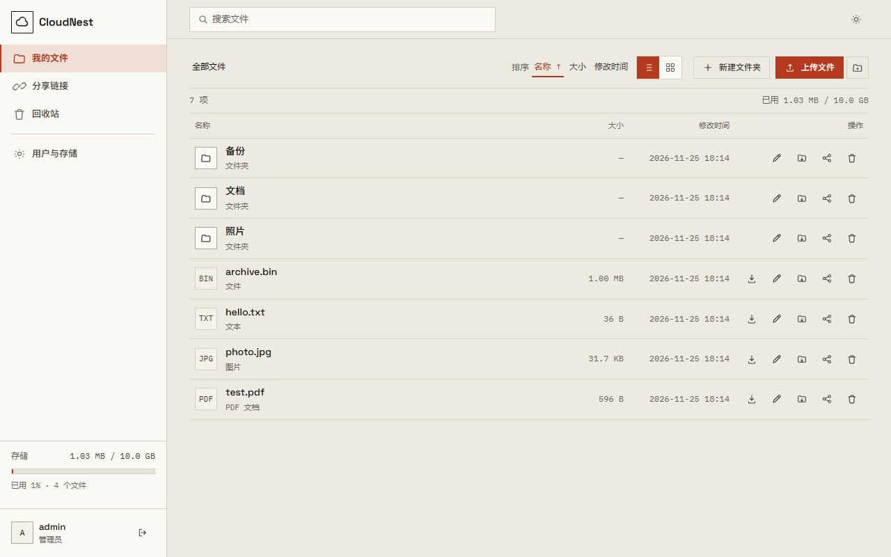
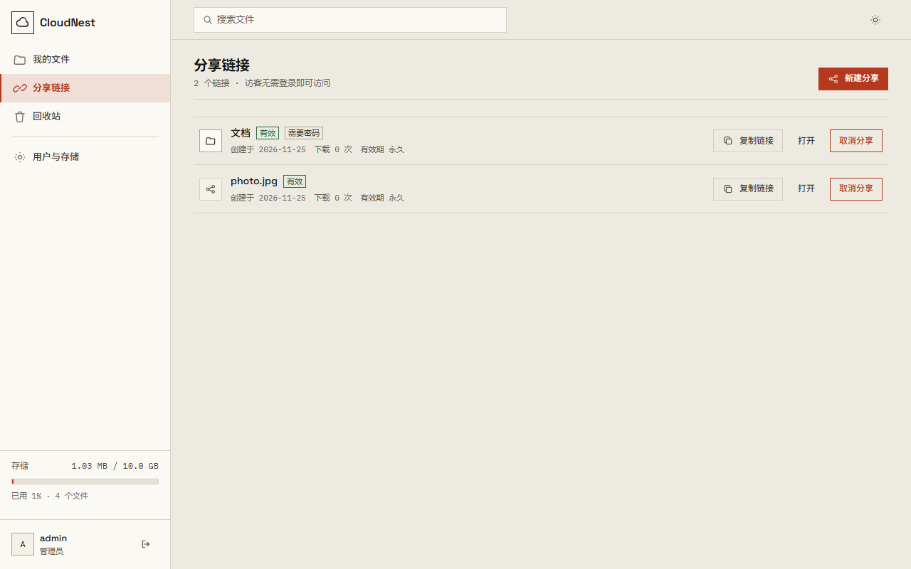
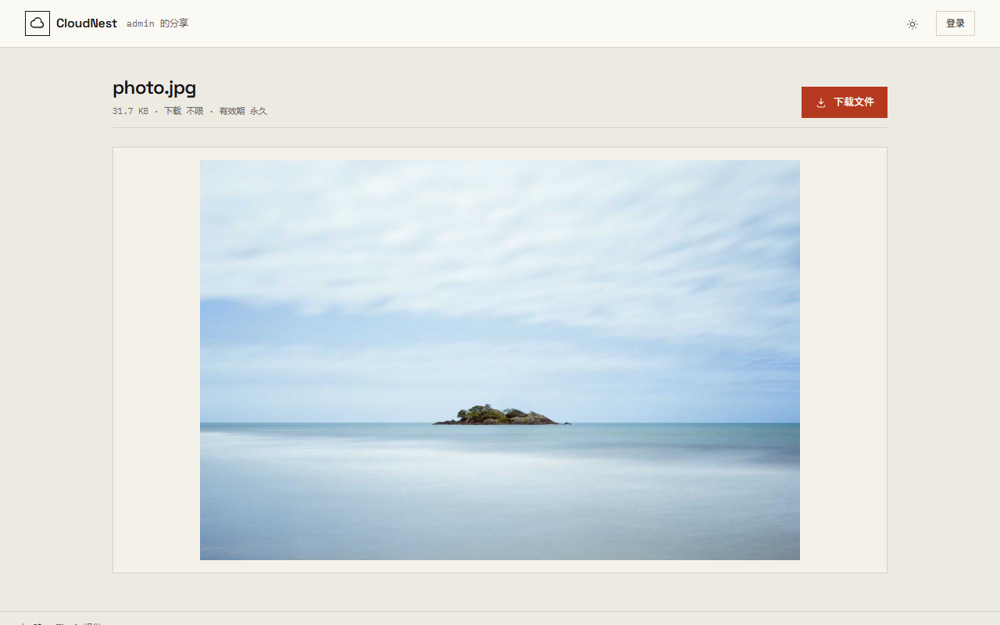
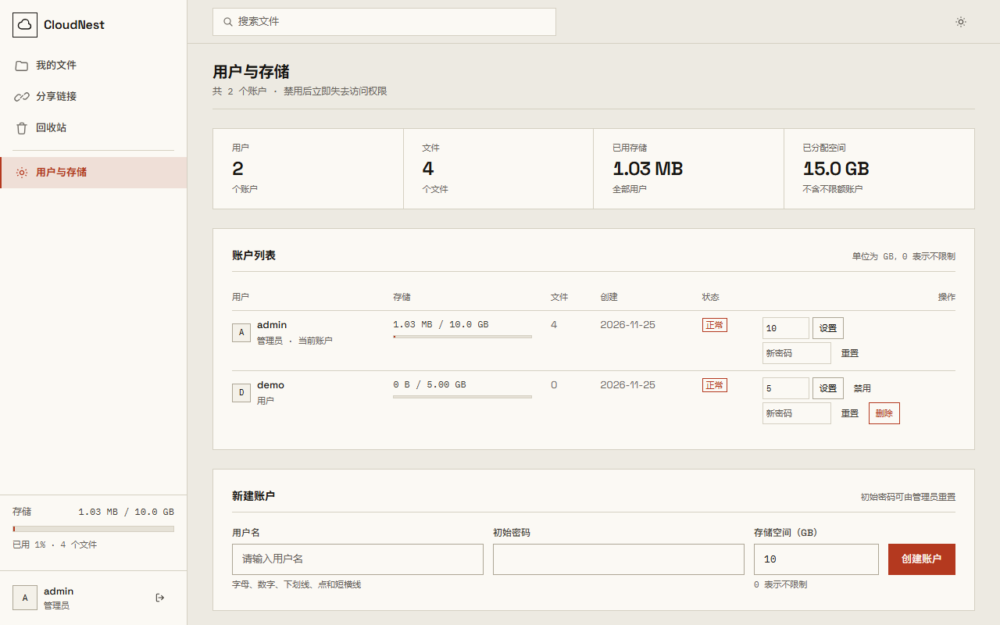
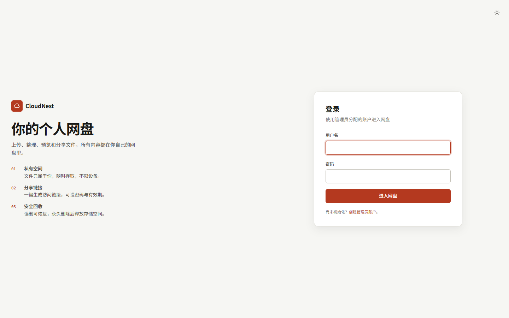
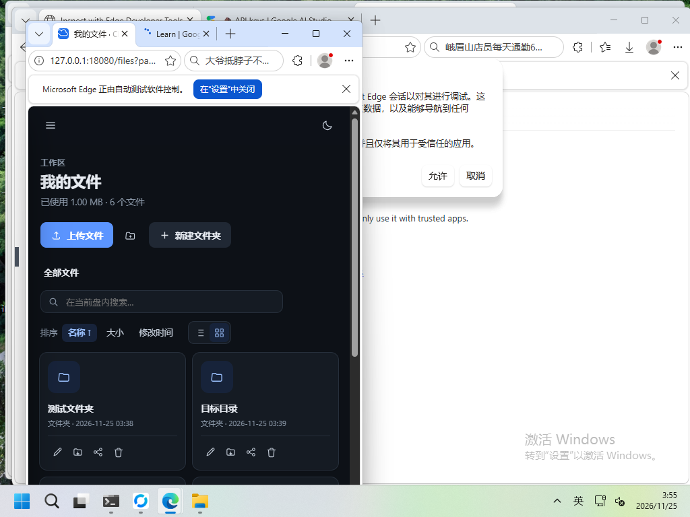

# CloudNest

 

CloudNest 是一个轻量、可靠的个人云盘：单个静态二进制 + SQLite，提供 Web 文件管理、分享链接、多用户与配额管理，适合部署在家庭服务器、NAS 或小型 VPS 上自用。

- 项目主页 / 仓库：<https://github.com/katriyda/cloudnest>
- 许可证：MIT
- 版本：v2.0.0

## 功能

- **单二进制部署**：Rust 编写的服务端，无外部运行时依赖；Linux x86_64 / aarch64 静态构建。
- **文件管理**：上传、下载、新建文件夹、重命名、移动、删除；支持列表/网格视图、按名称/大小/时间排序与搜索。
- **回收站**：删除的文件进入回收站，可查看并恢复，避免误删。
- **在线预览**：图片、视频、音频、文本等常见类型可直接预览。
- **分享链接**：为文件或文件夹创建公开分享链接，可设置访问密码、有效期与下载次数限制。
- **多用户与配额**：首次启动完成管理员初始化；管理员可管理用户与配额，用户可查看自己的空间用量。
- **安全基础**：Argon2 密码哈希、HttpOnly 会话 Cookie、CSRF 防护；HTTPS 场景可强制 Secure Cookie。
- **运维友好**：配置文件 + 环境变量覆盖、systemd 服务与日志、CLI 备份/恢复、SHA256 校验的发布产物。

> 说明：功能说明与当前实现保持一致；如有差异以实际版本为准。

## 界面预览

### 文件管理


### 分享管理


### 访客分享页


### 管理后台


### 登录页


### 移动端


## 快速安装

支持 Linux x86_64 / aarch64，安装脚本需要 root 权限与 systemd。

### 方式一：一键安装（推荐）

```bash
curl -fsSL https://github.com/katriyda/cloudnest/releases/latest/download/install.sh | sudo bash
```

指定版本：

```bash
curl -fsSL https://github.com/katriyda/cloudnest/releases/latest/download/install.sh | \
  sudo env CLOUDNEST_VERSION=2.0.0 bash
```

安装完成后：

1. 编辑 `/etc/cloudnest/config.toml`，至少修改 `public_url` 与 `secure_cookies`；
2. 执行 `sudo systemctl restart cloudnest.service`；
3. 浏览器访问 `public_url`，完成管理员账号初始化。

### 方式二：使用发布包离线安装

```bash
curl -LO https://github.com/katriyda/cloudnest/releases/latest/download/cloudnest-linux-x86_64.tar.gz
curl -LO https://github.com/katriyda/cloudnest/releases/latest/download/SHA256SUMS
sha256sum -c SHA256SUMS --ignore-missing
tar -xzf cloudnest-linux-x86_64.tar.gz
sudo bash ./install.sh
```

aarch64 机器将文件名中的 `x86_64` 换成 `aarch64`。

### 安装脚本做了什么

安装脚本 [scripts/install.sh](scripts/install.sh) 会：

- 检测系统架构并从 GitHub Releases 下载对应架构的 tar.gz，使用 `.sha256` 或 `SHA256SUMS` 校验完整性；
- 创建系统用户 `cloudnest`，创建目录 `/opt/cloudnest`、`/etc/cloudnest`、`/var/lib/cloudnest`；
- 将二进制安装到 `/opt/cloudnest/cloudnest`，安装 systemd 服务 `/etc/systemd/system/cloudnest.service`；
- 复制配置示例 `/etc/cloudnest/config.toml`（已存在时不会覆盖），并执行 `systemctl enable --now cloudnest.service`。

安装脚本支持环境变量 `CLOUDNEST_VERSION`、`CLOUDNEST_REPO`，以及 `--version`、`--no-start` 参数。

## 配置

默认配置路径：`/etc/cloudnest/config.toml`。

```toml
listen = "0.0.0.0:8080"
data_dir = "/var/lib/cloudnest"
public_url = "https://cloud.example.com"
secure_cookies = true
max_upload_size_mb = 2048
default_quota_gb = 10
session_days = 30
```

| 字段 | 默认值 | 说明 |
| --- | --- | --- |
| `listen` | `0.0.0.0:8080` | HTTP 监听地址。同机反向代理时建议改为 `127.0.0.1:8080`。 |
| `data_dir` | `/var/lib/cloudnest` | 数据目录，存放 SQLite 数据库与用户文件。 |
| `public_url` | 空 | 对外访问地址，用于生成绝对链接与 Cookie 作用域。 |
| `secure_cookies` | `false` | 仅通过 HTTPS 发送会话 Cookie；`public_url` 为 https 时自动启用。 |
| `max_upload_size_mb` | `2048` | 单次请求体上限（MiB），反向代理侧也需放宽。 |
| `default_quota_gb` | `10` | 新用户默认配额（GiB），0 表示不限。 |
| `session_days` | `30` | 登录会话有效期（天，1-365）。 |

环境变量 `CLOUDNEST_LISTEN`、`CLOUDNEST_DATA_DIR`、`CLOUDNEST_PUBLIC_URL` 可覆盖对应配置项。

完整示例见 [packaging/config.toml.example](packaging/config.toml.example)。

## 反向代理与 HTTPS

CloudNest 自身不处理 TLS，建议由 Caddy 或 Nginx 终止 HTTPS，并将请求转发到本机监听端口。此时请设置：

```toml
listen = "127.0.0.1:8080"
public_url = "https://cloud.example.com"
secure_cookies = true
```

### Caddy

```caddyfile
cloud.example.com {
    reverse_proxy 127.0.0.1:8080
}
```

### Nginx

```nginx
server {
    listen 443 ssl http2;
    server_name cloud.example.com;

    ssl_certificate     /etc/nginx/ssl/fullchain.pem;
    ssl_certificate_key /etc/nginx/ssl/privkey.pem;

    # 与 max_upload_size_mb 匹配，按需调大
    client_max_body_size 2g;

    location / {
        proxy_pass http://127.0.0.1:8080;
        proxy_http_version 1.1;
        proxy_set_header Host $host;
        proxy_set_header X-Real-IP $remote_addr;
        proxy_set_header X-Forwarded-For $proxy_add_x_forwarded_for;
        proxy_set_header X-Forwarded-Proto $scheme;
        proxy_request_buffering off;
        proxy_read_timeout 3600s;
        proxy_send_timeout 3600s;
    }
}
```

## systemd 管理

服务名称为 `cloudnest.service`（unit 文件 [packaging/cloudnest.service](packaging/cloudnest.service)）。

```bash
sudo systemctl status cloudnest.service
sudo systemctl restart cloudnest.service
sudo systemctl stop cloudnest.service
sudo systemctl disable --now cloudnest.service
```

## 日志

服务日志写入 journald：

```bash
sudo journalctl -u cloudnest.service -f
sudo journalctl -u cloudnest.service -n 200 --no-pager
sudo journalctl -u cloudnest.service --since "1 hour ago"
```

日志级别可通过 systemd 单元中的 `Environment=RUST_LOG=info` 调整（例如临时设置 `RUST_LOG=debug`）。

## CLI

```bash
cloudnest serve --config /etc/cloudnest/config.toml   # 启动服务（默认子命令）
cloudnest version                                     # 查看版本
cloudnest status                                      # 查看运行状态
cloudnest update                                      # 检查并更新
cloudnest uninstall                                   # 卸载程序与服务
cloudnest uninstall --purge                           # 同时删除配置与数据
cloudnest backup --output DIR                         # 备份到目录
cloudnest restore --from DIR                          # 从备份目录恢复
```

无子命令时默认执行 `serve`，并读取默认配置文件 `/etc/cloudnest/config.toml`。

## 备份与恢复

备份前建议停止服务，确保 SQLite 数据库与文件一致：

```bash
sudo systemctl stop cloudnest.service
sudo /opt/cloudnest/cloudnest backup --output /var/backups/cloudnest-$(date +%F)
sudo systemctl start cloudnest.service
```

恢复（服务需停止）：

```bash
sudo systemctl stop cloudnest.service
sudo /opt/cloudnest/cloudnest restore --from /var/backups/cloudnest-2026-01-01
sudo systemctl start cloudnest.service
```

备份目录包含数据与数据库，可能含敏感信息，请设置严格权限并异地保存。详见 [docs/DEPLOY.md](docs/DEPLOY.md)。

## 更新

推荐方式：备份后重新执行安装脚本，脚本会替换二进制、保留现有配置并重启服务。

```bash
sudo /opt/cloudnest/cloudnest backup --output /var/backups/cloudnest-$(date +%F)
curl -fsSL https://github.com/katriyda/cloudnest/releases/latest/download/install.sh | sudo bash
```

也可执行 `cloudnest update`。升级后如新增配置项，请对照 [packaging/config.toml.example](packaging/config.toml.example) 检查 `/etc/cloudnest/config.toml`。

## 卸载

```bash
sudo /opt/cloudnest/cloudnest uninstall           # 移除服务与程序，保留配置和数据
sudo /opt/cloudnest/cloudnest uninstall --purge   # 同时删除配置与数据（不可恢复）
```

如 CLI 不可用，可手动执行：

```bash
sudo systemctl disable --now cloudnest.service
sudo rm -f /etc/systemd/system/cloudnest.service
sudo systemctl daemon-reload
sudo rm -rf /opt/cloudnest /etc/cloudnest
# 确认不再需要数据后再执行：
# sudo rm -rf /var/lib/cloudnest
sudo userdel cloudnest
```

## 从源码构建

要求 Rust 1.94+（edition 2024，sqlx 0.9 的 MSRV）与 SQLite 静态链接能力（sqlx 的 `sqlite` feature 使用 bundled libsqlite3-sys，无需系统 SQLite）。

CI 使用 stable 工具链；`Cargo.toml` 中的 `rust-version` 与依赖实际 MSRV 保持一致，升级依赖后请同步更新。

Windows 上使用 `x86_64-pc-windows-gnu` 目标时，需要把 mingw-w64（或 llvm-mingw）的 `bin` 目录加入 `PATH`，否则 rustc 找不到 `dlltool`/`as`，会链接出启动即崩溃的可执行文件。

```bash
cargo build --release
cargo test
```

本地运行：

```bash
mkdir -p /tmp/cloudnest-data
cat > /tmp/cloudnest.toml <<'EOF'
listen = "127.0.0.1:8080"
data_dir = "/tmp/cloudnest-data"
secure_cookies = false
EOF
cargo run --release -- serve --config /tmp/cloudnest.toml
```

静态 musl 构建（与发布产物一致）：

```bash
rustup target add x86_64-unknown-linux-musl
cargo build --release --target x86_64-unknown-linux-musl
```

aarch64 交叉编译可使用 `cross`：

```bash
cargo install cross --locked
cross build --release --target aarch64-unknown-linux-musl
```

CI 与发布流程位于 [.github/workflows/ci.yml](.github/workflows/ci.yml) 与 [.github/workflows/release.yml](.github/workflows/release.yml)。

## 测试

```bash
cargo fmt --all -- --check
cargo clippy --all-targets -- -D warnings
cargo test
```

## 目录结构

```text
scripts/install.sh              一键安装脚本
packaging/cloudnest.service     systemd 单元
packaging/config.toml.example   配置示例
.github/workflows/              CI 与发布流程
docs/DEPLOY.md                  部署、升级、备份恢复与故障排查
docs/SECURITY.md                安全设计与加固说明
THIRD_PARTY_NOTICES.md         第三方软件许可声明
```

## 更多文档

- [docs/DEPLOY.md](docs/DEPLOY.md)：部署、升级、备份恢复、故障排查
- [docs/SECURITY.md](docs/SECURITY.md)：安全设计、加固清单与漏洞报告
- [THIRD_PARTY_NOTICES.md](THIRD_PARTY_NOTICES.md)：第三方软件许可（htmx MIT）
- [packaging/cloudnest.service](packaging/cloudnest.service)：systemd 服务单元
